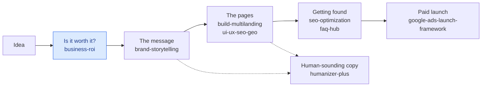

# Maryna Skachek

**Marketing strategist · Digital & e-commerce project lead · Founder of [MariCleo Studio](https://maricleo-studio.vercel.app/), France**

I turn marketing methods into skills that AI agents can run on real projects: deciding what
is worth building, finding the message, building the pages, getting found, launching paid
campaigns. Each method is used on client work first and published here after.

The highlighted step is the one most projects skip: checking who pays and what it really
costs before anything gets built.

## Skills you can install

| Repository | What it gives your agent |
|---|---|
| [marketing-agent-skills](https://github.com/marynacleo/marketing-agent-skills) | The full toolkit: idea check, brand message, landing pages, SEO and FAQ hub, short brand video, and a paid-ads launch case study. |
| [humanizer-plus](https://github.com/marynacleo/humanizer-plus) | Removes AI-writing tells from English, French and Russian text, with a detector that checks the result before you publish. |
| [build-multilanding](https://github.com/marynacleo/build-multilanding) | One brand, one codebase, many landing pages, each keeping one promise to one search intent. |
| [ui-ux-seo-geo.skill](https://github.com/marynacleo/ui-ux-seo-geo.skill) | Reviews a page as a UX designer, an SEO strategist and an AI-search editor at once. |

## Case study

| Repository | What it shows |
|---|---|
| [google-ads-agent-safety-framework](https://github.com/marynacleo/google-ads-agent-safety-framework) | How an AI agent works in a real Google Ads account without ever spending money on its own: read-only by default, every change validated, then applied only after an exact human approval. |

They work with Claude Code, OpenAI Codex and any tool that reads the Agent Skills format:
copy a skill folder into your agent's skills directory and start a new session.

## How I build them

- **A method, not a prompt.** Every skill has steps, gates and a check at the end, so the
  result holds up on a real project.
- **No invented facts.** The agent marks what it verified and what it assumed, and says
  when data is missing.
- **Your project stays yours.** The skills are generic; audiences, offers and proof live in
  your own files.

## Elsewhere

[MariCleo Studio](https://maricleo-studio.vercel.app/) ·
[LinkedIn](https://www.linkedin.com/in/marynaskachek/) ·
podcast [Le Marketing & Co](https://open.spotify.com/show/1MhULjywButujKHo4ds4BZ) ·
I work in French, English, Ukrainian and Russian.
